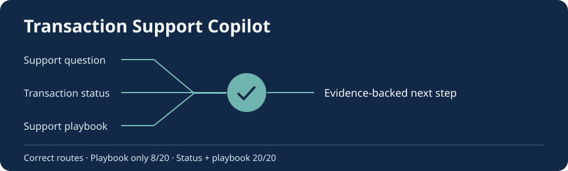
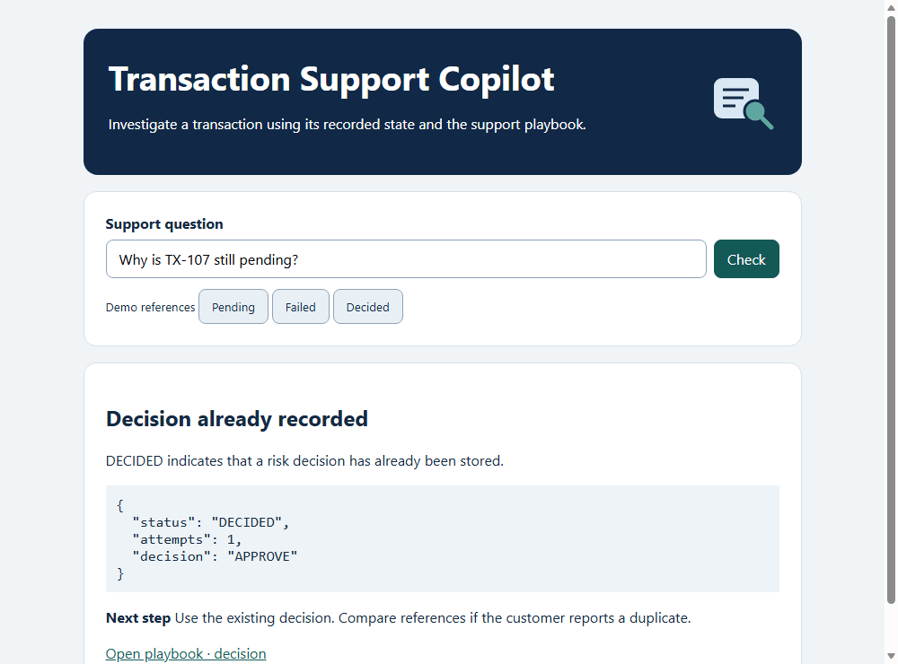

# Transaction Support Copilot



A read-only support assistant for synthetic payment transactions. Ask why a payment is pending, check the recorded risk-processing state, and get a next step tied to the support playbook. An unresolved or ambiguous reference prompts clarification.

## Demo



[Download the 14-second MP4](figures/demo.mp4).

## Run the demo

Requires Python 3.11+ and uses only the standard library.

```sh
python app.py
```

Open [the local demo](http://127.0.0.1:8765/) and ask “Why is TX-104 still pending?” Try TX-106 to see how the assistant handles repeated failures. It recommends checking the dead-letter topic without claiming the transaction is on it.

## Connect the risk service

Start the companion [Transaction Risk Integration Service](https://github.com/martaforjaz/transaction-risk-integration-service) using its Compose instructions. Set `RISK_SERVICE_URL=http://127.0.0.1:8080` before launching the demo, then supply a UUID already created by the service. The adapter uses its existing GET endpoint. HTTP 404 produces a reference check, while connectivity and unsupported responses prompt manual review. The API permits a status lookup only and exposes no replay operation.

## Evaluate

```sh
python -m unittest -v
python evaluate.py
```

| Approach | Correct support routes | Incorrect state-specific diagnoses |
| --- | ---: | ---: |
| Keyword search over the playbook | 8/20 | 12 |
| Transaction state and playbook | 20/20 | 0 |

The baseline chooses an entry from keywords alone. The grounded version routes using status and attempt count. For example, TX-107 is **decided** even if the question presupposes it is still pending. An incorrect state-specific diagnosis is an incorrect route that suggests a concrete queue, retry, review, or decision state. The state-aware version cannot distinguish broker downtime from other dispatch issues using the snapshot alone. The next step directs the operator to inspect telemetry.

The [fixed scenarios](cases.json) test routing on synthetic snapshots, including ambiguous references and incomplete or unavailable state. [Raw results](results.json) list baseline failures and median local runtime. Timings exclude network and model calls. The benchmark does not measure LLM answer quality or generalization to real support requests.

## Integration and model checks

Verified on the companion Spring Boot, Kafka, and PostgreSQL stack. Both ingress APIs returned the same pending transaction while Kafka was down. The copilot reported zero recorded attempts and left the cause unconfirmed. After Kafka and the consumer restarted, it reported an existing ALLOW decision with one recorded attempt. Replaying the same ingress request returned the existing result. Two Kafka redeliveries left the stored decision and attempt count unchanged. [Raw integration results](stack-results.json).

Run `python verify_stack.py` against an already running **local, disposable** companion Compose stack. This stops Kafka, sends the same synthetic transaction through both ingress APIs, then restarts the application consumer with Kafka available. It checks the pending answer before the restart and checks that the recovered transaction holds a single decision afterwards. Use `RISK_SERVICE_DIR` if the companion repository is in a different directory.

### Local LLM evaluation

We tested Qwen 2.5 (0.5B) through Ollama on the same 20 synthetic questions. A manual review compared each draft with the snapshot and playbook action. Seventeen drafts made an unsupported claim or suggested an unsupported action. The remaining three omitted the required next step. The application attached the correct playbook entry in every scenario by taking the link from its deterministic router.

For example, the model said TX-105 had reached the dead-letter topic when the snapshot established only one failed attempt. It also confirmed that TX-107 had been processed twice even though the snapshot only established that a decision existed. The browser demo therefore displays verified evidence and playbook guidance. Free-text generation is an offline experiment.

Median elapsed time was 674 ms and p95 was 7,045 ms, including the initial model load. The measurement covers fixture routing plus the local model request on this machine. [Drafts, timings, and manual review notes](model-results.json).

To reproduce, start Ollama, pull `qwen2.5:0.5b`, set `OLLAMA_URL=http://127.0.0.1:11434` and `OLLAMA_MODEL=qwen2.5:0.5b`, then run `python evaluate_model.py`. Review new drafts against the snapshot and playbook. Model output and timings may vary.
